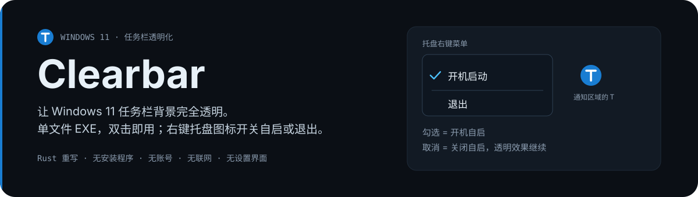
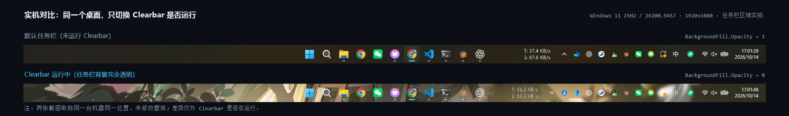
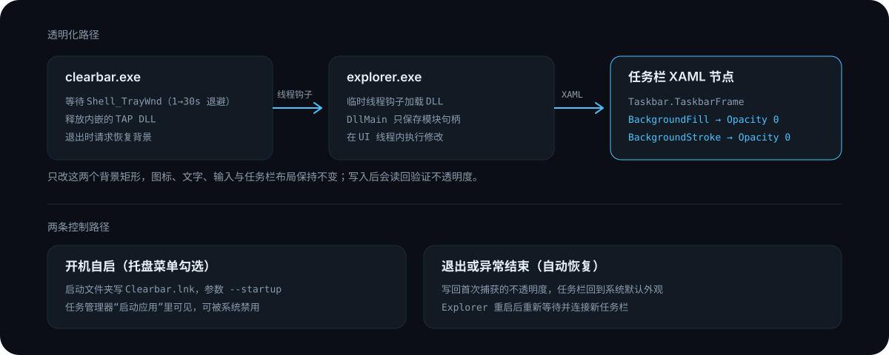

<p align="center">
  
</p>

Clearbar 是用 Rust 重写的 Windows 11 任务栏透明工具，只做两件事：把任务栏背景变透明，以及提供一个开机自启开关。没有设置窗口、颜色规则、模糊选项或联网功能，运行时右下角通知区域显示 Clearbar 图标。

## 实机效果

<p align="center">
  
</p>

两张截图取自同一台机器的同一位置。上面是系统默认的任务栏背景，下面是 Clearbar 运行时的效果：壁纸直接透出，图标、文字与输入位置不变。

## 下载与开始使用

| 下载 | 用途 |
|---|---|
| [clearbar.exe](https://github.com/DestinySail/TranslucentTB-rs/releases/latest/download/clearbar.exe) | 唯一必需的文件，免安装 |
| [最新 Release](https://github.com/DestinySail/TranslucentTB-rs/releases/latest) | 便携 ZIP，含使用说明、许可证与便捷脚本 |
| [SHA256SUMS.txt](https://github.com/DestinySail/TranslucentTB-rs/releases/latest/download/SHA256SUMS.txt) | 校验值 |

开始使用只需要三步：

1. 把 `clearbar.exe` 放到一个固定目录（例如 `D:\Tools\Clearbar\`），双击运行。程序会把内嵌的 TAP DLL 释放到 `%LOCALAPPDATA%\Clearbar\runtime\`，不需要手动复制 DLL。
2. 任务栏背景随即变透明。如果原版 TranslucentTB 还在运行，请先退出它，避免两个程序同时修改任务栏外观。
3. 右下角出现 Clearbar 图标（可能在“∧”收起区里），右键即可勾选开机启动或选择退出。

目前面向 Windows 11 x64。首次运行不会自动开启自启，需要的话在托盘菜单里勾选一次。
单个 `clearbar.exe` 自带运行库与内嵌 DLL：不需要安装 .NET、VC++ 运行库，也不需要额外下载文件。

## 托盘菜单

| 菜单项 | 行为 |
|---|---|
| 开机启动 | 勾选＝在当前用户的“启动”文件夹创建 `Clearbar.lnk`；取消＝删除该快捷方式，当前透明效果继续 |
| 退出 | 结束进程，并把任务栏恢复成系统默认外观 |

菜单每次打开都会重新读取系统状态：如果在任务管理器的“启动应用”里把 Clearbar 禁用，再打开菜单会显示为未勾选，重新勾选即可恢复。图标悬停提示为“Clearbar · 任务栏透明化（右键退出）”。

## 开机自启是怎么实现的

- 只在当前用户“启动”文件夹写一个 `Clearbar.lnk`，目标为 `clearbar.exe`，参数 `--startup`；不写计划任务，不写 `Run` 注册表值，也不需要管理员权限。
- 换目录后手动运行一次，已启用的快捷方式会更新到新路径。
- 启用状态通过 Windows 自带的注册表提供程序（本机 COM 调用 `StdRegProv`）读取，只清理 Clearbar 自己的值，不改动其它软件的启动项。
- 整套自启实现不解析 XML 配置，因此不存在“开机时读取自己的配置文件失败、透明化没生效”这条路径。这是与配置驱动实现的设计差异，不等于已经定位到原版工具报错的具体原因。
- 进入 Windows 桌面后自动运行，不弹窗，不需要账号；开机后可能先短暂显示默认背景，等任务栏就绪后转为透明。

## 工作方式

<p align="center">
  
</p>

- 主程序等待 `Shell_TrayWnd`，按 1、2、4、8、15、30 秒退避，之后保持 30 秒重试间隔。
- 通过临时线程钩子在任务栏所属的 Explorer 进程里加载 Rust DLL，`DllMain` 只保存模块句柄。
- DLL 连接 Windows XAML Diagnostics，只访问 `Taskbar.TaskbarFrame` 下的 `BackgroundFill` 与 `BackgroundStroke` 矩形，把 `Opacity` 设为 0，写入后读回验证。
- 图标、文字、输入与任务栏布局都不修改；首次捕获的原始不透明度用于退出时还原。
- 主程序正常停止或被强制结束时，DLL 都会在 Explorer 的 UI 线程里恢复背景；Explorer PID 变化后主程序重新等待并连接新的任务栏。
- DLL 每 500 毫秒检查控制器是否存在，主程序每 30 秒重新扫描一次，用于兼容本机“订阅最终返回 `0x8000FFFF`”的情况；该路径只记录日志，不把接口返回成功当成透明已生效。

日志与状态位于 `%LOCALAPPDATA%\Clearbar\`：`app.log`、`tap.log`、`status.txt`。日志为 UTF-8，约 1 MB 后轮换，不记录窗口标题或文档内容。

## 命令行

```powershell
.\clearbar.exe --enable-startup
.\clearbar.exe --disable-startup
.\clearbar.exe --stop
.\clearbar.exe --status
```

| 参数 | 作用 |
|---|---|
| 无参数 | 正常运行：透明化 + 托盘图标 |
| `--startup` | 开机自启入口，行为与正常运行一致 |
| `--enable-startup` / `--disable-startup` | 开启或关闭开机自启，不改变当前透明状态 |
| `--stop` | 停止正在运行的实例并恢复任务栏背景 |
| `--status` | 输出运行状态、透明状态与自启状态 |

## 构建

目标平台 `x86_64-pc-windows-msvc`，需要 Rust 1.82 以上、Visual Studio C++ Build Tools 和 Windows SDK。依赖版本由 `Cargo.lock` 固定，windows-rs 只启用所需的 Win32 接口。

```powershell
powershell -NoProfile -ExecutionPolicy Bypass -File .\scripts\build.ps1 -Test
```

构建脚本先编译 TAP DLL，再把它嵌进主程序，不要用并行 workspace 构建代替这个顺序。产物位于 `dist\Clearbar-<版本>-<时间戳>`，同时生成 ZIP；运行只需要 `clearbar.exe`，其余是说明与便捷操作脚本。

本机构建额外使用了仓库忽略的 `.tools`（微软 SDK/CRT 库）和 `.cargo/config.toml`，配合 Rust 自带的 LLD 链接。它们只用于构建，不随发布包分发；正常安装 Build Tools 的电脑不需要。

## 范围与已知限制

- 只面向 Windows 11 的 XAML 任务栏与 x64，实机基线为 25H2 / 26200.9457；不支持 Windows 10、ARM64 或旧版任务栏替换工具。
- Windows 更新可能改变内部节点，需要重新验证；进入桌面后可能短暂显示默认背景，初始化失败时后台重试，不弹窗阻塞操作。
- XAML Diagnostics 会把 DLL 留在 Explorer 中：停止程序会恢复背景，但 DLL 要等 Explorer 退出才卸载。更新 DLL 后建议重启电脑，不要覆盖正在加载的 DLL。
- 原型版本：没有代码签名、安装程序和自动更新。下载后首次运行可能被 Windows SmartScreen 拦截，点“更多信息 → 仍要运行”即可。真实重启后的自启时序，以及 Explorer 真正重启后的重连，仍需单独验收。
- 详细实测记录见 [VALIDATION.md](VALIDATION.md)，第三方组件许可见 [THIRD-PARTY-NOTICES.md](THIRD-PARTY-NOTICES.md)。

## 许可证

本项目代码采用 GPL-3.0-only，完整文本见 [LICENSE.md](LICENSE.md)；来源说明见 [NOTICE.md](NOTICE.md)。原版 [TranslucentTB](https://github.com/TranslucentTB/TranslucentTB) 与本项目相互独立。
